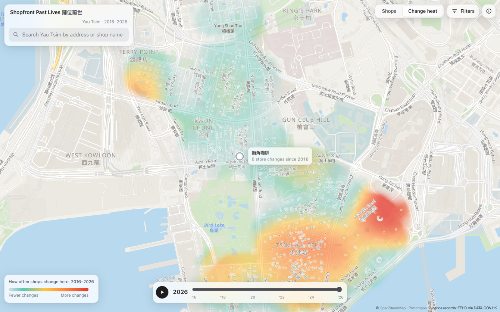
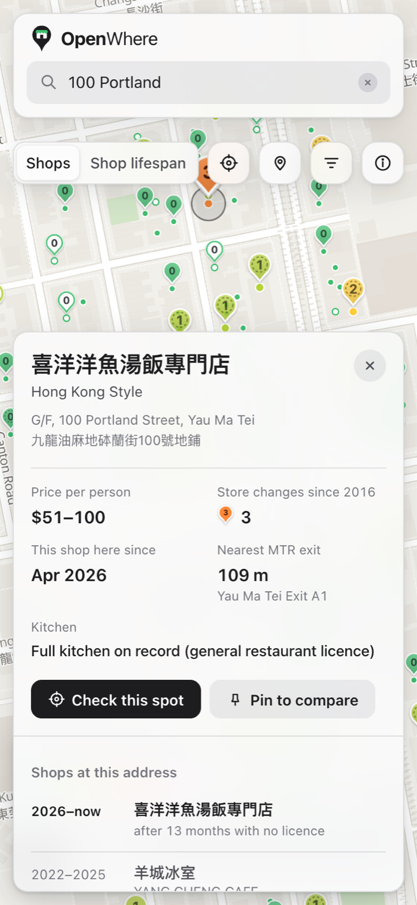

**Where should I open my restaurant?** OpenWhere puts ten years of Hong Kong's public restaurant licence records on one map of Yau Tsim (Tsim Sha Tsui, Jordan and Yau Ma Tei), so anyone choosing a site can see:
- how often each shopfront has changed hands;
- how long new shops last on each street;
- which competitors of the same cuisine are already nearby;
- what draws people to the area.


It is a reference for anyone in the food business, from a single noodle shop to a chain's site-selection team. It reports what the records show. It doesn't predict whether a business will do well, and it never says why a shop left.

## What you can do with it

- **Scan a district.** Every shopfront that has held a restaurant licence since 2016 is a pin with one number, **store changes since 2016**. The pin's tip marks the shop. Green means the same sign the whole time, rising through lime, yellow and orange to red at four or more changes.
- **See how long shops last.** *Shop lifespan* colours the streets by the share of new shops still listed three years after they opened. Green means shops last and red means they don't. Paler colour means the estimate rests on fewer shops.
- **Check a site.** *Site check* lets you click any spot, choose your cuisine and drag the radius (50 to 500 m). You get:
  - same-cuisine competitors listed now, nearest first, highlighted on the map;
  - **what they charge per person**, as a bar per OpenRice price band;
  - all restaurants nearby;
  - the local 3-year survival rate;
  - units that held a licence before but have none now;
  - the licence mix (general or light refreshment);
  - the nearest MTR exit;
  - the hotels, schools, malls, landmarks and stations in range.
- **See what draws people.** *Places* shows MTR exits, stations, hotels, schools and universities, malls and markets, landmarks and venues, and hospitals. It can be switched off.
- **Open a shop.** Click a pin, or search in English or Chinese (`砵蘭街100`, `Hau Fook`, a shop name). The card leads with what a future tenant needs:
  - the shop listed now, with its cuisine and **price per person** from OpenRice ("No data" where there's no match);
  - store changes since 2016, and how long the current shop has been there;
  - the nearest MTR exit;
  - whether a full kitchen is on record.

  Below that, every past shop at the address is one line, and the licence records are one tap away.
- **Play ten years.** The year bar replays 2016 to 2026, and units whose count rises that year pulse.
- **Compare and print.** Pin up to three units to see their signs on one 2016–2026 axis, with each store change marked and the gaps with no licence dashed. Then print a sheet that cites its source for every row.







## Run it

You need Node 18 or newer. All the data the app needs is in the repository, and the app runs offline: it makes no network requests at all, not even for map tiles.

```bash
cd web
npm install
npm run dev
```

Open http://localhost:5173. For a static build, run `npm run build` and serve `web/dist` from any web server, or run `npm run preview`.

## How the numbers are made

### Store changes

The source is the Food and Environmental Hygiene Department's restaurant licence list, which DATA.GOV.HK has archived daily since 2016 in English and Chinese. Each row gives a licence number, a sign, an address, a licence type and an expiry date. Nothing in it names an operator or a tenant, so the app never does either.

Counting licence numbers would overstate how often shops change: a new restaurant usually gets a six-month provisional licence (numbers starting 38 or 39), then a full licence (22 or 31). The pipeline links records into **sign histories** using only these named rules:

| Records show | Treated as |
| --- | --- |
| Same licence number, sign text changes | One history |
| Provisional number, then a full number within 9 months, signs match in either language | One history (inferred link) |
| As above, but the first sign is a placeholder such as "No Record" | One history, marked unresolved |
| As above, but the signs differ | Two histories, flagged as possibly linked |
| Different numbers, matching sign, gap under 12 months | One history (inferred link) |
| Anything else | Separate histories |

A **store change** is a history with a different sign listed after the previous one at that unit stopped being listed. A shop that opens beside another is not a change. Hand-checked examples:
- **G/F, 100 Portland Street:** 7 licence numbers, 4 sign histories, **3 store changes**.
- **G/F, 11A Hau Fook Street:** 6 licence numbers, **4 store changes**.

### Shop lifespan

Only shops that opened after January 2016 are used, so each one's start date is known: 907 at street level in Yau Tsim. Shops that are still listed today count as lasting *at least* as long as they have so far; they are not dropped. This is the Kaplan–Meier method, weighted by distance (σ ≈ 150 m) around every point.

- The colour is the share still listed three years after opening.
- Across the district that share is **75%**, and half of new shops are still listed after about **7¼ years**.
- Locally it runs from about 65% (red) to 90% (green).
- Colour fades toward white as the number of nearby shops falls from 15 to 3. Below 3 shops nothing is drawn.

### Cuisine

The licence lists carry no cuisine, so it is guessed from each current shop's sign, in two passes:
1. Keyword rules on the Chinese and English names labelled 857 shops.
2. I read the remaining 730 names by hand (`data/cuisine_manual.json`).

That gives 1,385 of the 1,587 shops listed now (87%) a cuisine. The other 202 stay "unclear from the name" rather than being guessed. A spot check of 45 rule labels found 41 right; the patterns behind the misses were then added. The app always says the cuisine was guessed from the name.

### Price and cuisine from OpenRice

A teammate collected 4,414 OpenRice listings (name, address, coordinates, price range, cuisines); 2,531 of them are in Tsim Sha Tsui, Jordan and Yau Ma Tei. `pipeline/openrice.py` attaches a listing to one of our current shops only when they clearly describe the same place:
- the names match closely and the points are within 150 m; or
- the street number and street agree and the names are similar; or
- the names are fairly close and the points are within 60 m.

Each listing and each shop is used once, best match first.

Every match with a weaker name score was read by hand, and 12 were rejected. In the end, **963 of the 1,562 named shops listed now (62%) have an OpenRice price and cuisine**; a random sample of 35 strong matches was all correct. Shops without a match say "No data". OpenRice's cuisine replaces the guess from the name, except for dish types OpenRice doesn't record (hot pot, bar, café, noodles, fast food).

OpenRice's terms restrict copying, so the raw listings stay out of this repository (`data/openrice/` is ignored). Only the matched price band and cuisine labels reach the app, credited to OpenRice.

### Places and MTR exits

Places and MTR exits come from OpenStreetMap via the Overpass API. Tutoring centres tagged as schools are dropped. Distances are straight-line, not walking routes: the median shop is 149 m from its nearest MTR exit.

## Numbers for Yau Tsim

| | |
| --- | --- |
| Monthly files read, Jan 2016 to Nov 2026 (EN + TC) | 262, none set aside as damaged |
| Licence numbers seen in the district | 5,119 |
| Shopfronts on the map, all floors | 2,200 (1,587 listed now) |
| Street-level shopfronts placed on the map | 1,121 of 1,195 (94%) |
| Street-level: no change / 1 / 2 / 3 / 4 or more | 832 / 212 / 56 / 15 / 6 |
| New street-level shops since 2016 still listed after 3 years | 75% |
| Current shops with a cuisine label | 1,460 of 1,587 (92%), from OpenRice or the name |
| Current shops with an OpenRice price per person | 963 of 1,562 named shops (62%) |
| Places on the map | 160 MTR exits, 138 hotels, 161 schools, 95 malls and markets, 69 landmarks, 60 stations, 7 hospitals |

Yau Tsim was picked from the 19 FEHD districts by running the same counting over all of them. It has:
- the highest rate of store changes per street-level shop: 0.34, against 0.09 to 0.28 elsewhere;
- the largest share of shops with at least one change: 25%;
- the most units with three or more changes: 21, against at most 13 elsewhere.

## Rebuild the data

The pipeline is Python 3 with DuckDB. A full run downloads about 1.3 GB and takes around an hour, mostly spent waiting on the archive and the Address Lookup Service.

```bash
python3 -m venv .venv && source .venv/bin/activate
pip install -r pipeline/requirements.txt
cd pipeline
python gate0.py probe                  # check the archive answers, EN and TC
python gate0.py pull --step monthly    # first good file of each month, EN + TC
python ingest.py                       # dated spans per licence number
python units.py parse
python units.py geocode --dist 61      # Address Lookup Service, cached
python units.py build                  # addresses -> units
python histories.py                    # link rules, store changes
python cuisine.py                      # cuisine guessed from current signs
python openrice.py                     # match OpenRice listings (needs data/openrice/openrice.md)
python export.py                       # web/public/data
python facilities.py                   # OpenStreetMap places, MTR exit distance
python heat.py                         # shop lifespan surface
```

| Step | File | What it does |
| --- | --- | --- |
| Download | `gate0.py` | Lists every archived version and keeps files that pass validation. The archive uses `http://` until May 2021 and `https://` after. A file is quarantined if it is truncated, misses a field, repeats a licence number, or loses more than 8% of its rows. |
| Spans | `ingest.py` | One row per licence number per unbroken run with the same sign, address, type and endorsements. Checks that the EN and TC files list the same licence numbers each day. |
| Units | `units.py` | Parses floor, shop numbers and street address by rule, then places each building with the government Address Lookup Service. |
| Histories | `histories.py` | Applies the link rules and counts store changes. |
| Cuisine | `cuisine.py` | Keyword rules plus hand labels for shops listed now. |
| OpenRice | `openrice.py` | Matches OpenRice listings to current shops for price and cuisine. |
| Export | `export.py` | GeoJSON, one history file per unit, a search index. |
| Places | `facilities.py` | OpenStreetMap places and each shop's distance to the nearest MTR exit. |
| Lifespan | `heat.py` | Distance-weighted Kaplan–Meier surface, its image and a readout grid. |

## How it was built

This was built in one overnight session for a hackathon, and the commit history follows the build step by step:
1. The data pipeline: download, spans, address resolution, link rules.
2. The choice of district.
3. The map app.
4. Rounds of fixes found by screenshotting the running app.
5. A design review, a choice between four rendered marker concepts, and a compare redesign.
6. Site check, shop lifespan, cuisine and places.

`PRODUCT.md` records who the product is for and what it must never claim. `DESIGN.md` records the design system. `web/scripts/shoot.mjs` regenerates every screenshot here from the running app.

## Repository layout

```
pipeline/         download, ingest, address resolution, link rules, cuisine, places, export
data/             snapshots.csv (files read) and cuisine_manual.json (hand labels); raw files are not committed
web/              Vite + React + TypeScript + MapLibre GL app
  public/data/    exported Yau Tsim data
  public/tiles/   Hong Kong basemap (Protomaps PMTiles extract)
  src/map/        map layers, pins, places, basemap style
  src/components/ search, site check, filters, panel, compare, legend, year bar
docs/             screenshots and brand files
```

## Limits

- Monthly sampling misses a shop that opened and closed between two monthly files.
- 74 street-level addresses (6%) could not be placed reliably and are left off the map.
- Link rules can be wrong. Every link is labelled with the rule that made it, and the panel lists the records behind it.
- Where OpenRice has no match, cuisine is a guess from the name, and 127 current shops can't be guessed at all.
- OpenRice prices are the listing's own price band, as collected; they may be out of date for some shops.
- Shop lifespan compares areas within this district only. Its colours come from Yau Tsim's own range.
- No rent data: there is no reliable public source for the current rent of individual shops.

## Sources and credits

- Restaurant licence lists: Food and Environmental Hygiene Department, via the [DATA.GOV.HK historical archive](https://data.gov.hk/en/help/api-spec).
- Building locations: [Address Lookup Service](https://www.als.gov.hk), Office of the Government Chief Information Officer.
- Price per person and cuisine for matched shops: [OpenRice](https://www.openrice.com), collected by a teammate.
- Places, MTR exits and basemap: © [OpenStreetMap](https://www.openstreetmap.org/copyright) contributors (ODbL), rendered with [Protomaps](https://protomaps.com) and [MapLibre GL JS](https://maplibre.org).

Reconstructed from FEHD licence lists. Not a record of ownership, tenancy or business performance.
