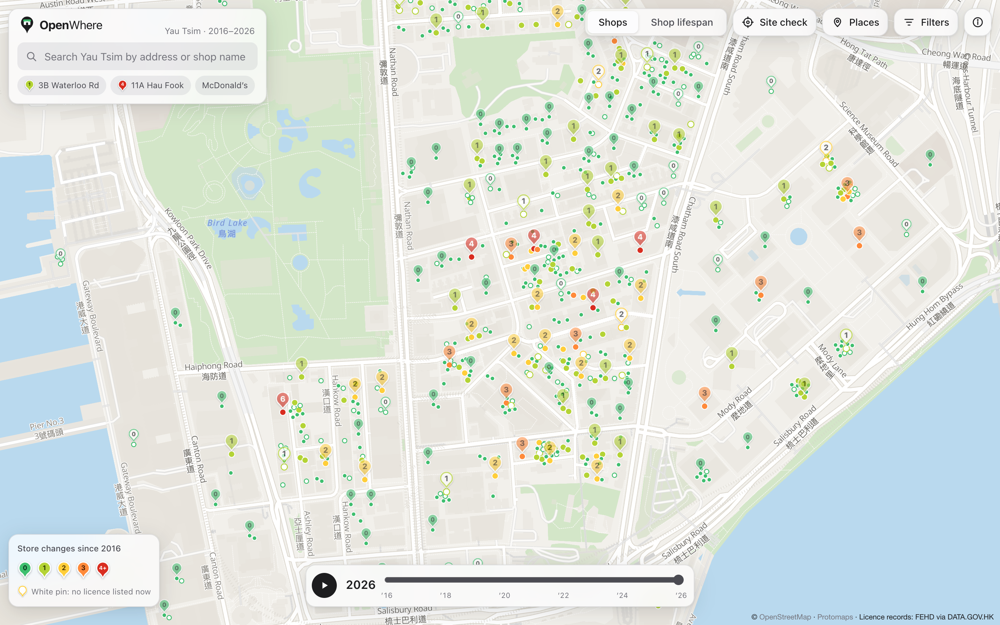
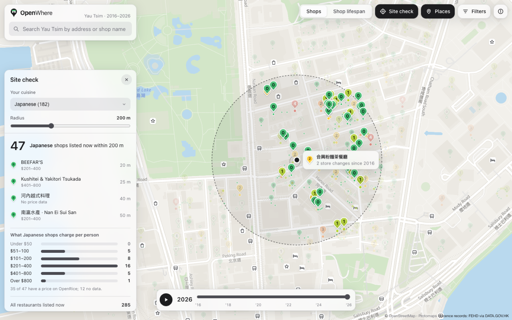
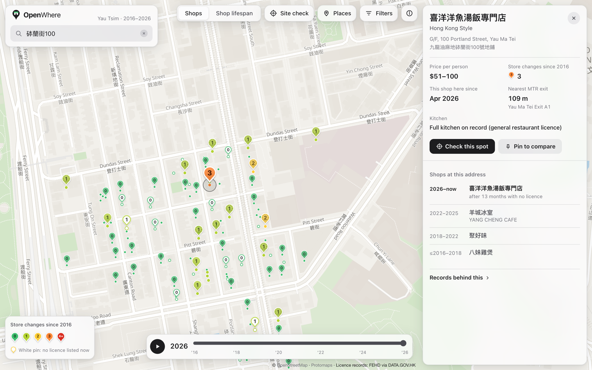
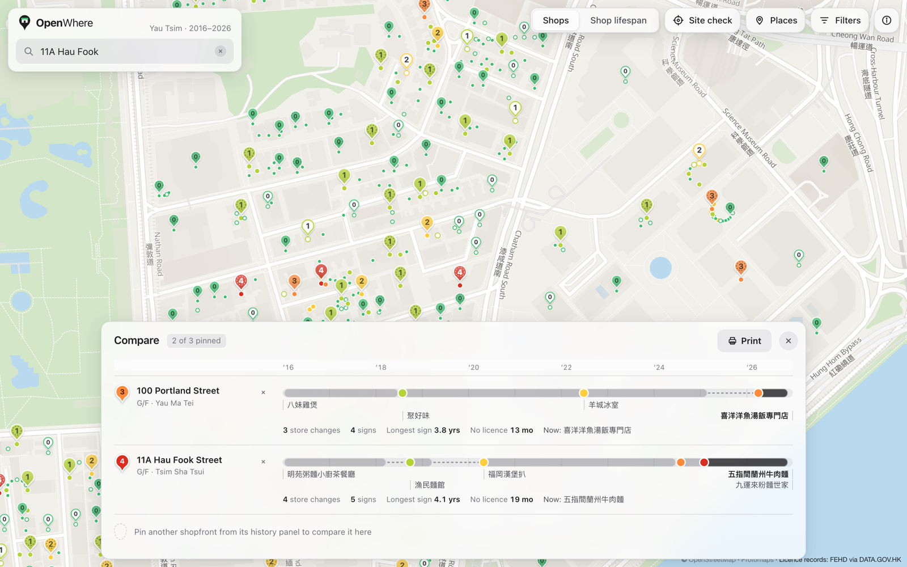

**Where should I open my restaurant?** OpenWhere puts ten years of Hong Kong's public restaurant licence records on one map of all eighteen districts, so anyone choosing a site can see:
- how often each shopfront has changed hands;
- how long new shops last on each street;
- which competitors of the same cuisine are already nearby;
- what draws people to the area.

**Live demo: https://manynoobs.github.io/openwhere/** (nothing to install; works on a phone too)



It is a reference for anyone in the food business, from a single noodle shop to a chain's site-selection team. It reports what the records show. It doesn't predict whether a business will do well, and it never says why a shop left.

## What you can do with it

- **Scan any street in Hong Kong.** Every shopfront that has held a restaurant licence since 2016 is a pin with one number, **store changes since 2016**. The pin's tip marks the shop. Green means the same sign the whole time, rising through lime, yellow and orange to red at four or more changes.
- **See how long shops last.** *Shop lifespan* colours the streets by turnover: the share of new shops no longer listed three years after they opened. Red means high turnover, green means low, and yellow is the Hong Kong average (24%). Paler colour means the estimate rests on fewer shops.
- **Check a site.** *Site check* lets you click any spot, choose your cuisine and drag the radius (50 to 500 m). You get:
  - same-cuisine competitors listed now, nearest first, highlighted on the map;
  - **how that count compares** with what a typical restaurant in the same district has around it ("More than usual", "Fewer than usual");
  - **what they charge per person**, as a bar per OpenRice price band;
  - all restaurants nearby;
  - the local 3-year survival rate, beside Hong Kong's;
  - units that held a licence before but have none now;
  - the licence mix (general or light refreshment);
  - the nearest MTR exit;
  - the hotels, schools, malls, landmarks and stations in range.
- **See what draws people.** *Places* shows MTR exits, stations, hotels, schools and universities, malls and markets, landmarks and venues, and hospitals. It can be switched off.
- **Open a shop.** Click a pin, or search in English or Chinese (`砵蘭街100`, `Hau Fook`, a shop name). The card leads with what a future tenant needs:
  - the shop listed now, with its cuisine and **price per person** from OpenRice ("No data" where there's no match);
  - store changes since 2016, and how long the current shop has been there;
  - the nearest MTR exit;
  - whether a full kitchen is on record.

  Below that, every past shop at the address is one line, and the licence records are one tap away.
- **Filter.** Narrow the map by cuisine, price per person, licence type, outside seating or number of store changes. Type a brand (`McDonald`, `譚仔`) to see every branch at once, on any floor.
- **Play ten years.** The year bar replays 2016 to 2026, and units whose count rises that year pulse.
- **Compare.** Pin up to three units to see their signs on one 2016–2026 axis, with each store change marked and the gaps with no licence dashed. Each lane also gives the price per person, the distance to the MTR, how long new shops nearby last, and how many shops of the same cuisine are within 200 m.
- **Share a view.** The address bar always holds the open shop or site check, so a link reopens exactly what you were looking at.









## Run it

Use Node.js 24. All the data the app needs is in the repository, and the app runs offline: it makes no network requests at all, not even for map tiles.

```bash
cd web
npm ci
npm run dev
```

Open http://localhost:5173. For a static build, run `npm run build` and serve `web/dist` from a web server that supports HTTP range requests for the map tiles, or run `npm run preview`.

## How the numbers are made

### Store changes

The source is the Food and Environmental Hygiene Department's restaurant licence list, which DATA.GOV.HK has archived daily since 2016 in English and Chinese. Each row gives a licence number, a sign, an address, a licence type and an expiry date. Nothing in it names an operator or a tenant, so the app never does either.

Counting licence numbers would overstate how often shops change: a new restaurant usually gets a six-month provisional licence (numbers starting 38 or 39), then a full licence (22 or 31). The pipeline links records into **sign histories** using only these named rules:

| Records show | Treated as |
| --- | --- |
| Same licence number, sign text changes | One history |
| Provisional number, then a full number within 9 months, signs match in either language | One history (inferred link) |
| As above, but the first sign is a placeholder such as "No Record" | One history, marked unresolved |
| As above, but the signs differ | Two histories, flagged as possibly linked |
| Different numbers, matching sign, gap under 12 months | One history (inferred link) |
| Anything else | Separate histories |

A **store change** is a history with a different sign listed after the previous one at that unit stopped being listed. A shop that opens beside another is not a change. Hand-checked examples:
- **G/F, 100 Portland Street:** 7 licence numbers, 4 sign histories, **3 store changes**.
- **G/F, 11A Hau Fook Street:** 6 licence numbers, **4 store changes**.

### Shop lifespan

Only shops that opened after January 2016 are used, so each one's start date is known: 9,663 at street level across Hong Kong. Shops that are still listed today count as lasting *at least* as long as they have so far; they are not dropped. This is the Kaplan–Meier method, weighted by distance (σ ≈ 150 m) around every point.

- Across Hong Kong, the share still listed three years after opening is **76%**.
- The legend reads this as turnover, the share no longer listed within three years: yellow is the Hong Kong average (24%), 39% and above is red, 9% and below is green. One scale covers the whole territory, so a street in Sha Tin and one in Mong Kok read alike.
- The surface is drawn as 4 km tiles at 8 m a pixel, so it stays sharp at street level anywhere.
- Colour fades toward white as the number of nearby shops falls from 15 to 3. Below 3 shops nothing is drawn.

### Cuisine

The licence lists carry no cuisine, so it is guessed from each current shop's sign, in two passes:
1. Keyword rules on the Chinese and English names labelled 8,235 of the 14,928 shops listed now.
2. Hand labels from `data/cuisine_manual.json` labelled 1,142 more. The 687 labels were written by Claude, the AI assistant this project was built with, reading each Chinese and English sign in Yau Tsim; they apply wherever the same sign appears. No person checked them all.

The other 5,551 stay "unclear from the name" rather than being guessed. A spot check of 45 rule labels found 41 right; the patterns behind the misses were then added.

OpenRice (next section) then replaces the guess where a shop has a matched listing, which fills in most of the unclear ones: **12,760 of 14,928 shops listed now (85%)** have a cuisine. Where the cuisine comes only from the name, the app says so.

### Price and cuisine from OpenRice

The project's OpenRice collector gathered every restaurant and beverage listing in Hong Kong (name in Chinese and English, address, coordinates, price range, cuisines); 28,764 of them are marked as still trading. `pipeline/openrice.py` attaches a listing to one of our current shops only when they clearly describe the same place:
- the names match closely and the points are within 150 m; or
- the street number and street agree and the names are similar; or
- the names are fairly close and the points are within 60 m.

Each listing and each shop is used once, best match first, and a listing's Chinese and English names are both tried.

**11,007 of the 14,751 named shops listed now (75%) have an OpenRice price and cuisine.** Shops without a match say "No data". OpenRice's cuisine replaces the guess from the name, except for dish types OpenRice doesn't record (hot pot, bar, café, noodles, fast food).

OpenRice's terms restrict copying, so the raw listings stay out of this repository. Only the matched price band and cuisine labels reach the app, credited to OpenRice.

### Places and MTR exits

Places and MTR exits come from the Lands Department's iGeoCom points of interest: railway station entrances, stations and termini (MTR, light rail, high-speed rail, bus termini, ferry piers), hotels, primary and secondary schools and post-secondary institutions, malls and markets, exhibition, performing-arts and sports venues and cinemas, and hospitals. Pharmacies and medicine shops come from the Drug Office's register of poison licences, which includes the Mannings, Watsons and convenience-store branches. Distances are straight-line, not walking routes: the median shop is 244 m from its nearest MTR exit.

### Rent nearby

Each shop's panel gives the rents of shops let around it, from the leases Centaline Commercial records. `pipeline/rents.py` takes recorded (not estimated) retail leases of the last three years on the shop's own level: street-level shops for a street-level shopfront, upstairs shops otherwise. It uses the leases within 150 m, or within 300 m where 150 m holds fewer than five. Leases that Centaline places only by street are left out.

The panel shows:
- the median rent per square foot a month, with the middle half of the range;
- the median lease, in HK$ a month and square feet;
- the median asking rent of units advertised now within 300 m;
- the Rating and Valuation Department's latest average for the shop's area (Hong Kong Island, Kowloon or the New Territories), to read the street against.

Only these medians reach the app, never a single lease. **12,256 of the 19,967 shopfronts (61%)** have five or more leases nearby; Centaline's records are densest in the main shopping streets. Street-level medians run from $17 to $433 per square foot, with $65 the middle shopfront; upstairs, from $16 to $80, with $33 in the middle.

## Numbers for Hong Kong

| | |
| --- | --- |
| Monthly files read, Jan 2016 to Nov 2026 (EN + TC) | 262, none set aside as damaged |
| Licence numbers seen | 44,351 |
| Shopfronts on the map, all floors | 19,967 (14,928 listed now) |
| Street-level shopfronts placed on the map | 12,347 of 12,933 (95%) |
| Street-level: no change / 1 / 2 / 3 / 4 or more | 9,754 / 2,024 / 418 / 98 / 53 |
| New street-level shops since 2016 still listed after 3 years | 76% |
| Current shops with a cuisine label | 12,760 of 14,928 (85%), from OpenRice or the name |
| Current shops with an OpenRice price per person | 11,007 of 14,751 named shops (75%) |
| Places on the map | 611 MTR exits, 1,339 stations and termini, 322 hotels, 1,229 schools, 1,025 malls and markets, 262 landmarks, 60 hospitals, 4,534 pharmacies and medicine shops |
| Shopfronts with a rent median nearby | 12,256 of 19,967 (61%), from 2,994 street-level and 382 upstairs leases since Nov 2023 |

Turnover is highest on the busiest streets. Store changes per street-level shopfront, by FEHD district:

| District | Street-level shopfronts | Store changes per shopfront | Share with at least one change |
| --- | ---: | ---: | ---: |
| Wan Chai | 1,165 | 0.41 | 29% |
| Yau Tsim | 1,148 | 0.35 | 26% |
| Central/Western | 1,346 | 0.35 | 26% |
| Kwun Tong | 428 | 0.33 | 19% |
| Eastern | 816 | 0.33 | 23% |
| Mong Kok | 993 | 0.31 | 24% |
| Wong Tai Sin | 291 | 0.30 | 21% |
| Yuen Long | 902 | 0.25 | 20% |
| Southern | 236 | 0.25 | 22% |
| Tsuen Wan | 577 | 0.24 | 18% |
| Kowloon City | 896 | 0.22 | 19% |
| Sham Shui Po | 845 | 0.22 | 17% |
| Tuen Mun | 517 | 0.21 | 15% |
| Sha Tin | 462 | 0.20 | 17% |
| Kwai Tsing | 295 | 0.20 | 14% |
| Sai Kung | 391 | 0.20 | 16% |
| North | 320 | 0.19 | 16% |
| Tai Po | 325 | 0.18 | 16% |
| Islands | 394 | 0.08 | 8% |

## Rebuild the data

Use Python 3.12 with DuckDB. A full run downloads about 1.3 GB and takes around an hour, mostly spent waiting on the archive and the Address Lookup Service.

The public checkout includes the app’s exported data. OpenRice listings, places and rents are read from the team's collectors' output (`hk-catering-scraper/out`, `hk-places-scraper/out`, `hk-rent-scraper/out`), which stays out of this repository. For a rebuild using only public inputs, skip `python openrice.py` and continue with `python export.py`. Prices will be unavailable and cuisine labels will come from shop names.

```bash
python3 -m venv .venv && source .venv/bin/activate
pip install -r pipeline/requirements.txt
cd pipeline
python gate0.py probe                  # check the archive answers, EN and TC
python gate0.py pull --step monthly    # first good file of each month, EN + TC
python ingest.py                       # dated spans per licence number
python units.py parse
python units.py geocode --workers 6     # Address Lookup Service, cached
python units.py build                  # addresses -> units, FEHD's own position as fallback
python histories.py                    # link rules, store changes
python cuisine.py                      # cuisine guessed from current signs
python openrice.py                     # optional: match OpenRice listings
python export.py                       # web/public/data
python facilities.py                   # iGeoCom places and pharmacies, MTR exit distance
python heat.py                         # shop lifespan tiles
python rents.py                        # rent medians near each shop (needs hk-rent-scraper/out)
```

| Step | File | What it does |
| --- | --- | --- |
| Download | `gate0.py` | Lists every archived version and keeps files that pass validation. The archive uses `http://` until May 2021 and `https://` after. A file is quarantined if it is truncated, misses a field, repeats a licence number, or loses more than 8% of its rows. |
| Spans | `ingest.py` | One row per licence number per unbroken run with the same sign, address, type and endorsements. Checks that the EN and TC files list the same licence numbers each day. |
| Units | `units.py` | Parses floor, shop numbers and street address by rule, then places each building with the government Address Lookup Service. Where the service finds no match, FEHD's own position for a licence at that address is used. |
| Histories | `histories.py` | Applies the link rules and counts store changes. |
| Cuisine | `cuisine.py` | Keyword rules plus hand labels for shops listed now. |
| OpenRice | `openrice.py` | Matches OpenRice listings to current shops for price and cuisine. |
| Export | `export.py` | GeoJSON, one history file per unit, a search index. |
| Places | `facilities.py` | iGeoCom places, Drug Office pharmacies, and each shop's distance to the nearest MTR exit. |
| Lifespan | `heat.py` | Distance-weighted Kaplan–Meier surface, as 4 km image tiles and a readout grid. |
| Rent | `rents.py` | Median lease and asking rents near each shop, and the average for each area. |

## How it was built

This was built in one overnight session for a hackathon, working with Claude Code, and the commit history follows the build step by step:
1. The data pipeline: download, spans, address resolution, link rules.
2. The choice of district.
3. The map app.
4. Rounds of fixes found by screenshotting the running app.
5. A design review, a choice between four rendered marker concepts, and a compare redesign.
6. Site check, shop lifespan, cuisine and places.
7. OpenRice prices, and a shop card rebuilt around what a future tenant needs.
8. A full review before submission: filters for cuisine, price and brand, a benchmark for the site check, shareable links, tests and this live demo.
9. Rent nearby, pharmacies, and coverage of all of Hong Kong.

The link rules have tests. Two of them replay the real licence records of the hand-checked shopfronts above:

```bash
cd pipeline && python -m unittest discover tests
```

`PRODUCT.md` records who the product is for and what it must never claim. `DESIGN.md` records the design system. `web/scripts/shoot.mjs` regenerates every screenshot here from the running app.

## Repository layout

```
pipeline/         download, ingest, address resolution, link rules, cuisine, places, export
  tests/          link-rule tests and the two hand-checked shopfronts
data/             snapshots.csv (files read) and cuisine_manual.json (hand labels); raw files are not committed
web/              Vite + React + TypeScript + MapLibre GL app
  public/data/    exported Hong Kong data
  public/tiles/   Hong Kong basemap (Protomaps PMTiles extract)
  src/map/        map layers, pins, places, basemap style
  src/components/ search, site check, filters, panel, compare, legend, year bar
docs/             screenshots and brand files
```

## Limits

- Monthly sampling misses a shop that opened and closed between two monthly files.
- 586 street-level addresses (5%) could not be placed reliably and are left off the map.
- Link rules can be wrong. Every link is labelled with the rule that made it, and the panel lists the records behind it.
- Where OpenRice has no match, cuisine is a guess from the name, and 2,168 current shops can't be guessed at all.
- OpenRice prices are the listing's own price band, as collected; they may be out of date for some shops. Matches rest on the matching rules, with no review by hand.
- Shop lifespan's colours are centred on Hong Kong's own average.
- Rent nearby is what shops around a unit let for, not the rent of that unit. Centaline records the leases it hears of, not every lease; leases in large malls and in outlying areas are few. Asking rents are what landlords advertise.

## Sources and credits

- Restaurant licence lists: Food and Environmental Hygiene Department, via the [DATA.GOV.HK historical archive](https://data.gov.hk/en/help/api-spec).
- Building locations: [Address Lookup Service](https://www.als.gov.hk), Office of the Government Chief Information Officer.
- Price per person and cuisine for matched shops: [OpenRice](https://www.openrice.com).
- Shop rents: [Centaline Commercial](https://oir.centanet.com) leases and listings, as medians.
- Average rent for each area: Rating and Valuation Department, via [DATA.GOV.HK](https://data.gov.hk).
- Pharmacies and medicine shops: Drug Office, Department of Health.
- Places and MTR exits: iGeoCom, Lands Department, via [DATA.GOV.HK](https://data.gov.hk).
- Basemap: © [OpenStreetMap](https://www.openstreetmap.org/copyright) contributors (ODbL), rendered with [Protomaps](https://protomaps.com) and [MapLibre GL JS](https://maplibre.org).

Reconstructed from FEHD licence lists. Not a record of ownership, tenancy or business performance.

## Licence

The code is under the [MIT licence](LICENSE). The data keeps the terms of its sources listed above.
